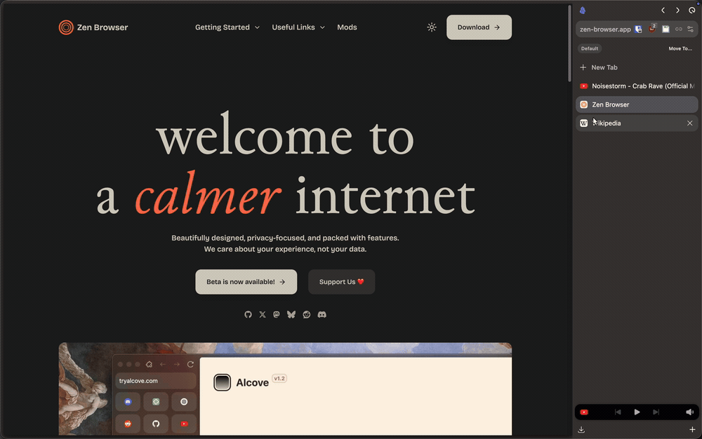
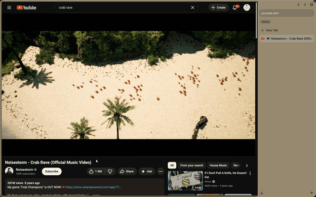

# Zen Tint

Chrome that **continues the page** for [Zen Browser](https://zen-browser.app/) — the URL bar, sidebar, titlebar and outer rim take the page's own background color, so the browser frame reads as one object with the content instead of a separate window pasted next to it.

**Built for heavy-tab sessions.** Tested at 1,200+ open tabs without measurable tab-switch lag.

**Fully tunable** from a Sine settings panel — tint strength (overlay over your own Zen theme/gradient), saturation, lightness clamp, and per-site rules. See [Configuration](#configuration).

*The URL bar, sidebar, titlebar and outer rim continue the page as you switch tabs.*

## The idea

The frame and the page are one object. When the page is `#0d1117` and the URL bar is `#2a2a2a`, the browser reads as a separate window sitting next to the content.

The usual fix is to **sample the page's pixels**. It works, and it's what most adaptive-color mods do — but it answers a different question:

> *What does the visible content average to?* — not *what color is this page?*

Those come apart more often than you'd think:

- A page with a dark chrome, a white article body and a colorful illustration averages to a muddy grey that appears **nowhere** in the page.
- A site that paints its background on a wrapper element, or behind a `background-image`, samples the illustration, not the surface.
- A busy dashboard averages every card, chart and sidebar into one color that belongs to nothing.

**Zen Tint reads the page's declared background instead**: the computed `background-color` of `<body>`, falling back to `<html>`. That is the color the page itself says it sits on — the color the frame should continue.

And when the page declares *nothing* (a transparent `<body>` and `<html>`), the mod doesn't guess. It clears the tint and hands the frame back to your Zen theme, because "no declared background" is a real answer and inventing white for it would be worse than being quiet.

**…but not so much that you lose track of where the page ends.** Continuity taken too far erases the boundary: a sidebar and a page in the same color read as one flat field. So the boundary is **drawn** — a squircle stroke around the whole page viewport, on all four sides, continuously, in the site's own color. See [The page outline](#the-page-outline).

## Two color sources

`zen.page-tint.color-source` picks between two ways of answering "what color is this page?". Both are one click apart in the Sine panel and both apply live — no restart.

| | **`page-background`** (default) | `content` |
|---|---|---|
| Reads | the page's **declared** background | the page's **painted pixels** |
| On a page with mixed content | the page's surface — flat and calm | the average of everything on screen |
| Follows a video | no | yes |
| On an app that lies about its background (Gmail) | takes the lie | corrects it |
| Directional gradient (`ambient-spread`) | no — one color has no spatial content | yes |
| YouTube ambient mode | no | yes |
| Cost per sample | one `getComputedStyle` — no compositor read | one `drawWindow` read of the viewport |

**Start on `page-background`.** Switch to `content` when you want the chrome to chase the content — video, live games, a page that changes color over time.

## Install

**Add it locally from this repo:** Sine settings → **"Add your own locally from a GitHub repo"** → paste `https://github.com/Zack-Bloodshot/zen-tint` → enable → restart. A local (unvetted) install needs `sine.allow-unsafe-js = true` in `about:config` for the script portion to load.

> **No telemetry, no tracking** — the script reads the current page's background color locally, over a content-script bridge, and the outline's color comes from the site's own favicon (the browser has already fetched it; at worst it is one request to the site you are looking at). Nothing is sent anywhere.

## Configuration

Everything is configurable from the **Sine settings panel** for this mod (Zen → Sine → Zen Tint → ⚙). Each setting maps 1:1 to an `about:config` pref, so you can also set them there directly.

**Apply live** (no restart):

| Pref | Default | Effect |
|---|---|---|
| `zen.page-tint.color-source` | `page-background` | **Where the tint color comes from.** `page-background` = the page's **declared** background (`<body>` → `<html>` → clear), so the frame reads as a continuation of the page. `content` = the **visible** color — the painted pixels, video-aware. See [Two color sources](#two-color-sources). |
| `zen.page-tint.mix-amount` | `100` | Tint **strength** (0–100): the sampled **page** color is laid as a translucent **overlay** over Zen's own chrome (including per-workspace gradients). `100` = full page color (the default); `0` = no tint, your untouched Zen theme/gradient shows through; in between veils the gradient with the page color. (It's an opacity overlay, not a color blend, because a workspace gradient can't be reproduced by mixing a single color.) |
| `zen.page-tint.saturation` | `100` | Vibrancy (0–200) of the tint. `0` = grayscale chrome, `100` = the page's own saturation, `200` = double. |
| `zen.page-tint.brightness` | `100` | Gain (0–300) on the tint's lightness. `200` = twice as light. Applied *before* the lightness clamps, so those stay hard bounds. Acts on HSL lightness rather than multiplying RGB channels, so it can't shift hue or clip one channel first. |
| `zen.page-tint.contrast` | `100` | Pushes lightness (0–300) away from mid-grey — `200` doubles the distance from 50%, `0` flattens to grey. Acts on the single sampled color, so it deepens darks and lifts lights; it can't add local contrast the way a filter over an image would. |
| `zen.page-tint.ambient-spread` | `0` | Strength (0–100) of the **directional gradient** — see [Directional ambient gradient](#directional-ambient-gradient). `0` = flat tint (default, and the sampler skips the extra work entirely). Applies to the `content` source only. |
| `zen.page-tint.min-lightness` | `0` | Lightness **floor** (0–100): keeps near-black pages from making the chrome muddy. `0` = no floor. |
| `zen.page-tint.max-lightness` | `100` | Lightness **cap** (0–100): keeps blinding-white pages from washing the chrome out. `100` = no cap. |
| `zen.page-tint.disable-hosts` | `''` | Comma-separated host list (same syntax as `live-mode-hosts`, supports `*.example.com`) where the tint is turned **off** — the chrome keeps your Zen theme on those sites. |
| `zen.page-tint.youtube-ambient` | `true` | On YouTube, sample the **video's own picture box** rather than a centered viewport grab, gated on the player's Ambient mode being on — see [YouTube ambient mode](#youtube-ambient-mode). Applies to the `content` source only. |
| `zen.page-tint.light-average` | `false` | Average **page** samples as light instead of as flat color (decode sRGB to linear, weight vivid cells above gray ones). Physically more accurate and noticeably brighter/more saturated on mixed pages. Applies to the `content` source only. |
| `zen.page-tint.frame-gap` | `5` | Gap (px) between the content area and the window edge in non-compact mode. Compact mode stays flush so Zen's screen-edge hover controls remain reachable. Extremely large values can push the page viewport entirely offscreen. |
| `zen.page-tint.frame-radius` | `14` | Content corner radius (px). |
| `zen.page-tint.page-outline-width` | `2` | The **drawn boundary**: a squircle stroke around the whole page viewport, in the site's own color — see [The page outline](#the-page-outline). `0` = off (the page goes back to its own corners and no line is drawn). |

**Need a restart** (read once at load):

| Pref | Default | Effect |
|---|---|---|
| `zen.page-tint.live-mode` | `true` | Master switch for live mode — continuous polling so the chrome tint follows video / animated content. When off, the tint is purely event-driven. |
| `zen.page-tint.live-mode-rate-ms` | `2000` | The poll interval (0.5 Hz), used **verbatim** — this is how often the chrome color can change. Floored at 100 ms as a guard against an absurd value. Keep it at or above `live-mode-smoothing-ms`, or each fade is interrupted by the next sample and the chrome never settles on a color. |
| `zen.page-tint.live-mode-threshold` | `8` | Minimum per-channel color change (0–255) needed to actually re-tint during live polling. Imperceptible frame-to-frame jitter below this is ignored so the chrome doesn't churn on near-static scenes. `0` = re-tint on any change. This is the sensitivity knob; `live-mode-rate-ms` is the cadence knob, and they're independent. |
| `zen.page-tint.live-mode-smoothing-ms` | `1000` | Duration of the CSS fade applied to **every** tint change (live ticks, event-driven samples, and tab-switch cache hits). |
| `zen.page-tint.live-mode-always-on` | `false` | When `false`, live polling only runs while a `<video>` on the page is actually playing — static pages cost nothing. Set `true` to poll every foregrounded page regardless. |
| `zen.page-tint.live-mode-hosts` | `''` | Comma-separated host allowlist; matching sites are treated as always-on. The supported workaround for players auto-detect can't see — canvas/WebGL players and cross-origin `<iframe>` embeds. Matched by hostname, so port-independent (`localhost` matches `localhost:3000`). Supports `*.example.com`. Example: `example.com, *.spotify.com, localhost`. |
| `zen.page-tint.debug` | `false` | When `true`, logs diagnostic events to the Browser Console (`Cmd-Shift-J` / `Ctrl-Shift-J`). |

The `--zpt-frame-shadow` drop shadow is still a CSS knob in `style.css` `:root` if you want to tune it.

## The page outline

The tint makes the chrome continuous with the page. Taken too far, that erases where the page **ends** — a sidebar and a page in the same color read as one flat field. So the boundary is drawn rather than implied: a **squircle stroke around the whole page viewport**, on all four sides, continuously, in the site's own color.

- **Where.** On the page's outermost pixels, all the way round — including the edge that faces the sidebar. (The v1.1.0 hairline was drawn in the frame gap instead, and the gap only exists on three sides: the line vanished on exactly the edge it was wanted on.)
- **What shape.** A true squircle — continuous corners, not the circular arcs `border-radius` produces. Firefox's `corner-shape` draws it; the radius is `--zpt-page-outline-radius` in `style.css`.
- **What color.** The **site's** color, taken from its favicon. A favicon *is* the brand mark; a page's `<meta name="theme-color">` is usually just its background (GitHub's is `rgb(30,35,39)`), and scanning CSS custom properties means guessing at names across every framework. The favicon is also per-*site*, so it is fetched once per host and reused by every tab on it.
- **Fallback chain.** Site color → the tint's own foreground (a neutral line that flips light/dark with the page) → nothing at all. A monochrome logo has no color to give, so those sites get the neutral line.
- **Width.** `zen.page-tint.page-outline-width`, 2px by default. `0` turns it off, and the page goes back to its own corners.

It is a **border**, and a border is allowed to sit on top of the page's outermost pixels — that is what a border is. The *tint* is not: it only ever paints chrome surfaces, and never the page. The two jobs stay separate.

**Where the color comes from, in detail.** The icon is drawn to a 32×32 canvas (no smoothing — blending while scaling invents in-between shades) and the pixels are counted: transparent, near-black, white and grey pixels never count, so a half-white half-green logo is green. The most common exact shade wins when it clearly leads; otherwise the biggest hue family is averaged, so a gradient that crosses a family border isn't split in two. The result is clamped into a visible lightness band. The technique is borrowed from [zen-tab-groups](https://github.com/oom333/zen-tab-groups) (MIT) — see [Credits](#credits).

## Directional ambient gradient

> Applies to the `content` source only — a single declared color has no spatial content, so there is no direction to infer.

By default the chrome takes one flat color from the page. With `zen.page-tint.ambient-spread` above `0`, it instead takes color from the *matching side*: the left of the URL bar strip from the left of the page, the top of the sidebar from the top, and so on — so a video with a warm left edge and a cool right edge lights the chrome the same way round.

The data was always there. `frame.js` reduces the sampled region to a 16×16 grid and the old code averaged all 256 cells into a single color, discarding the spatial layout. Now it also accumulates four directional bands (6 columns/rows in from each edge, leaving the middle to neither so the two sides stay distinguishable) and sends those alongside the base color. It's one extra accumulate per cell inside a loop that was already running, so the cost is negligible — and at spread `0` the frame script is told not to compute them at all.

Rendering is a `background-image` gradient laid over the existing `background-color`, with the edge colors carrying the spread strength as alpha so the compositor does the base-to-edge blend. That split matters: the flat base still fades smoothly through the existing colour transition, and the directional layer rides on top without being animated. Edge colors go through the same saturation / brightness / contrast / clamp transform as the base, so tuning any of those moves the whole gradient together instead of letting it drift out of family.

Two deliberate limits:

- **Alpha is capped below full.** The readable-foreground pick is computed against the base color, so letting an edge fully replace the base at the extremes would break text contrast. Capping keeps the endpoints tethered.
- **It's on the sidebar and the URL bar strip only** — not the window rim or root. The rim is an inset `box-shadow`, which takes solid colors only, and rewriting it as a background would paint over the workspace gradient it exists to preserve. Stacking a gradient on the root would also reintroduce the layering problem described in the tint-strength notes.

This is the analogue of the userstyle's `scale(4)` plus 3500px blur, done as chrome geometry instead of a GPU blur pass over page content.

## YouTube ambient mode

> Applies to the `content` source only.

YouTube's own "Ambient mode" (cinematic lighting) paints downscaled copies of the current video frame into canvases behind the player and CSS-blurs them into the glow around the video. With `zen.page-tint.youtube-ambient` on (the default), the sampler reads the **video's painted picture box** — the same frames that glow is built from — instead of a centered viewport grab, so the browser frame and the player glow track each other.

Two things it fixes:

- **Letterbox bars stop dragging the tint dark.** A 21:9 video in a 16:9 player puts black bars exactly where the centered read looks, so they get averaged in. The picture box is derived from the video's own `videoWidth`/`videoHeight` against its layout box, so the bars are excluded geometrically. The outer 4% is trimmed too — edge rows carry compression ringing and the player rounds its corners.
- **No page furniture in the sample.** Comments, the recommendations column, and the player chrome are all outside the sampled region by construction.

This path is always averaged as *light* (linear, chroma-weighted) regardless of `light-average`, because it's modelling light coming off a screen rather than a flat surface color.

Cropping to the video removes the static page furniture that used to damp frame-to-frame variance, so on moving content nearly every poll clears `live-mode-threshold`. That means the chrome changes at your configured `live-mode-rate-ms` — every 2 s by default. Raise the rate for a calmer frame, or raise the threshold if you'd rather it only react to real scene changes.

**Why not read YouTube's canvas directly?** That was the first implementation and it cannot work. YouTube's video is served cross-origin from `googlevideo.com` without CORS, so the moment a frame is drawn the canvas is origin-tainted — YouTube can display it, but `getImageData` throws `SecurityError`. Confirmed in the wild: the canvas reads fine while blank, then dies exactly when playback starts. `drawWindow` is the privileged compositor read the main pixel path already uses, so tainting does not apply to it, and scoping it to the video's picture box gets the same colors with better letterbox handling than the canvas offered.

**Turning it on:** enable Ambient mode in the YouTube player (gear icon → Ambient mode); it's dark-theme and watch-page only. If you run the [Zen Internet](https://addons.mozilla.org/firefox/addons/zen-internet/) transparency mod, its "no ambient mode" toggle removes the element this gates on, so turn that off. Whenever the gate isn't satisfied the normal sample chain runs exactly as before, so there's no failure mode to manage.

Note this *reads* the video; it doesn't amplify anything. Userstyles that crank `#cinematics` with a multi-thousand-pixel blur to spill the glow across the whole window are a separate, page-side thing — they cost real GPU and need a transparent-chrome setup to reach the browser frame. This gets the chrome to match at no rendering cost, and works whether or not you run any of that.

*Live mode with the `content` source: with a video playing, the chrome continuously tracks the scene's color.*

## Known limitations

- **A page that paints its background on a wrapper element gets no tint.** Only `<body>` and `<html>` are read. A color set on a `
` wrapper (common in SPAs) resolves to "no declared background", so the chrome falls back to your Zen theme instead of blending in. Leave `color-source` at `content` for those sites, or add the host to `zen.page-tint.disable-hosts`.
- **The outline's color is per-site, not per-page.** It comes from the favicon, so `github.com` and `gist.github.com` can differ, and a site whose logo changes with its theme gets the color of whichever logo was cached first.
- **A monochrome logo gives no color.** Black, white and grey icons are deliberately ignored (a dark logo on a transparent background is not a brand color), so those sites fall back to the neutral line derived from the page's own light/dark.
- **A page whose background is an image or a gradient reads as transparent.** `background-image` is not a color, and the computed `background-color` underneath it is usually `rgba(0, 0, 0, 0)` — so the chrome clears to your Zen theme.
- **`color-source` is global, not per-site.** Some sites need the visible-pixel path even when you prefer the declared background — Gmail's dark mode is the classic case, where the declared background is the light one and the app paints dark. There is no per-host override for the source; use `zen.page-tint.disable-hosts` for the sites that need the other behavior.
- **Boost edits on the currently open page require a refresh.** When you live-edit a [Zen Boost](https://zen-browser.app/) on a page that's already loaded, the chrome tint won't update until you refresh the page (or switch to another tab and back). Boosts apply styling via `CSSStyleSheet.insertRule` and browser-level user-sheetsheets, neither of which fires a DOM `MutationObserver`. Background polling would catch it but at a constant CPU cost that didn't feel worth it — open to revisiting if folks ask.
- **YouTube in fullscreen video** mode drops the `#cinematics` element the ambient path gates on, so it falls back to the centered viewport read — which in fullscreen is the video anyway, just without the letterbox trimming. Outside fullscreen the ambient path handles it.
- **Live mode doesn't auto-detect video inside cross-origin `<iframe>` embeds** (the common YouTube/Vimeo/Spotify embed on a third-party page). That `<video>` lives in a separate browsing context, so its play/pause events never reach the parent document and auto-detect can't see it. The tint *would* follow it correctly if polling ran — only the trigger is missing. Workaround: add the host to `zen.page-tint.live-mode-hosts` to force always-on polling there. A site's own pages (e.g. youtube.com itself, where the `<video>` is same-origin) work without this.
- **`drawWindow` is flagged non-standard in MDN** and may be removed in a future Gecko. If that happens, the `content` source loses its pixel path (the meta-tag and computed-style fallbacks still work, but Gmail-class accuracy is lost). The default `page-background` source never used it, so it is unaffected. No drop-in replacement exists today.

## How it works

**`tint.uc.js`** runs in the chrome (`browser.xhtml`):
1. Listens for `TabSelect`, `onLocationChange` (top-level only — iframe loads filtered out), `TabClose`, and OS `prefers-color-scheme` changes.
2. On fire, coalesces via `requestAnimationFrame` raced against a 100ms `setTimeout` safety net (rAF can be throttled when the window is occluded), then samples the active browser.
3. Cache hit → applies `--zen-tab-header-background` + `--zen-tab-header-foreground` instantly (no IPC).
4. Cache miss → loads `frame.js` into the content process. Frame script samples + observes mutations, and pushes updates via `sendAsyncMessage`.
5. Cache is bounded LRU (3000 entries) keyed by `origin + pathname`. Cleared on OS color-scheme change so prefers-color-scheme-aware sites re-sample fresh.
6. Sampled color is adjusted (saturation / lightness clamp) and the foreground (black or white) is picked against the result via Rec 601 luminance for max contrast.
7. A transient Zen Glance keeps its parent tab's tint while the parent remains visible behind it. Expanding the Glance into a normal tab hands tint ownership to the child and samples it normally.
8. The page outline is positioned over the browser's rect (a fixed-position element in the chrome document, moved on every layout change) and colored from the site's favicon, which is fetched once per host and cached in `zen.page-tint.icon-colors`.

**`frame.js`** runs in the content process. The color source decides which chain runs:

**`page-background` (default)** — the page's declared background, in two steps:
1. `body.backgroundColor` — the computed color of `<body>`.
2. `html.backgroundColor` — the computed color of `<html>`.

Neither means the page declares no background: the tint clears and the frame returns to your Zen theme. Normalized to canonical `rgb()` via the canvas color parser, so hex/HSL/named all work, and a resolved `rgba(…, 0)` counts as "no color".

**`content`** — the painted pixels, first match wins:
0. **YouTube's video picture box** (host-gated to `*.youtube.com`, gated on `#cinematics` existing, only when `youtube-ambient` is on) — a `drawWindow` read of just the painted video, letterbox bars excluded geometrically. See [YouTube ambient mode](#youtube-ambient-mode) for why this reads the compositor rather than YouTube's canvas. Falls through to step 1 whenever the gate isn't satisfied or the player is scrolled out of view.
1. **`drawWindow` pixel of the central 60% of the viewport, downsampled to a 16×16 grid and averaged** — ground truth of what's actually painted, weighted to the dominant central tone rather than whatever single element lands dead-center. Picks up Zen Boost overlays, dark-mode toggles, Gmail-class apps where `<body>` lies about the visible color.
2. `<meta name="theme-color">` — fallback for the rare case where pixel can't read (pre-paint, fully transparent page). Note this is often the *address-bar* color a site declares for mobile, **not** its page bg — e.g. GitHub's meta is `rgb(30,35,39)` but its actual page bg is `rgb(13,17,23)` — so we prefer pixel even when meta is present. Media-aware (light/dark variants honored) and normalized to canonical `rgb()` via the canvas color parser.
3. `body.backgroundColor`.
4. `html.backgroundColor`.
5. Walk up from `elementFromPoint` until a solid-bg ancestor.

Observers in content:
- **`<html>` / `<body>` attribute mutations** — filtered to ~11 theme-relevant attributes (`class`, `style`, `data-theme`, `data-bs-theme`, `data-color-mode`, etc.) so noisy pages don't keep waking the sampler.
- **`<head>` mutations** — `childList` + `subtree characterData` + filtered attributes on `link`/`meta`/`style`. Catches stylesheet swaps and dynamic theme-color changes.
- **`load` + `pageshow`** — re-sample at +300ms and +2000ms with 500ms dedupe (catches slow apps that bootstrap their theme after `load` — Gmail).

**`style.css`** lays the page color as a translucent **overlay** (`--zpt-tint`, opacity set by the strength pref) across the URL bar, sidebar, titlebar, splitter, tab labels, and the outer window-background rim. Below full strength, Zen's own theme / workspace gradient shows through; the rim uses an inset box-shadow so the gradient survives underneath instead of being painted over.

## Built for heavy-tab sessions

Adaptive-color mods tend to feel laggy at high tab counts. The usual reasons:

- 5–7 separate theme recalculations per tab switch
- Animating color transitions across every `.tabbrowser-tab` element (thousands of nodes)
- Re-sampling on every revisit instead of caching
- Hooking synchronously into `TabSelect`, blocking the click

This mod is built around the opposite constraints:

- **One sample per tab switch** — `TabSelect` + `onLocationChange` pairs coalesce into a single deferred run
- **Per-origin LRU cache** (3000 entries) — revisits are instant, zero IPC
- **Deferred via `requestAnimationFrame` + setTimeout race** — tab clicks register before the JS runs, and the safety-net `setTimeout` means we don't get stuck when `rAF` is throttled
- **No transitions on per-tab elements** — color snaps; sidebar/toolbar still animate smoothly
- **Skips `about:` / `chrome:`** — keeps Zen's defaults where they belong
- **One tint layer per pixel** — a translucent overlay composited twice reads a different strength from its neighbours, so exactly one element paints the tint over any given region

## Performance

Measured under a 1,200+ tab session:

| Path | CPU |
|---|---|
| Cache hit (revisit) | ~0.5 ms |
| Cache miss (first visit) | ~10–15 ms |
| Idle | ~0 |

The default `page-background` source is cheaper still — it reads two computed styles instead of a compositor readback.

## Compatibility

- Developed on Zen 1.20b+ on macOS; also reported working on Linux (the compact-mode and contrast fixes in 1.5.x came from a CachyOS user). Windows should work too — selectors target Zen's stable chrome IDs — but it's unverified there. Reports welcome.
- Sine required (install from this repo, as described above).

## Credits

This is a fork of **[Zen Page Tint](https://github.com/caezium/zen-page-tint)** by [caezium](https://github.com/caezium) — the original sampler, the LRU cache, the rAF coalescing, the compact-mode and single-tint-layer fixes, and the whole approach to not melting down at 1,300 tabs. That work is MIT-licensed and its copyright is retained in [LICENSE](LICENSE).

What this fork adds:

- **The `page-background` color source** — the chrome takes the page's *declared* background, and it is the default.
- **Live re-sample on a source change** — flipping the source re-tints the current tab immediately instead of waiting for a mutation, a poll tick, or a tab switch.
- **Clear-on-empty** — a page that declares no background hands the frame back to your Zen theme instead of guessing white.
- **The drawn page outline** — a squircle boundary around the whole viewport, in the site's own color, taken from its favicon.

The favicon-color algorithm is adapted from **[zen-tab-groups](https://github.com/oom333/zen-tab-groups)** by [oom333](https://github.com/oom333) (MIT) — see [LICENSE](LICENSE) for the retained copyright notice.

## License

[MIT](LICENSE). Original copyright (c) 2026 caezium retained; fork changes (c) 2026 Zack-Bloodshot.

## Contributing

Issues and PRs welcome. Two guardrails:
- Keep per-tab-switch work bounded — cache hits should stay zero-IPC, and frame-script mutation handling should stay filtered + debounced.
- If you add a new sample-chain step, add a one-liner explaining the case it catches that the existing steps miss.
